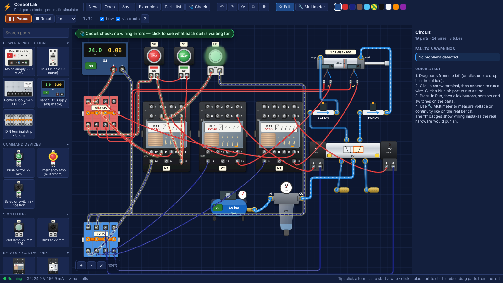
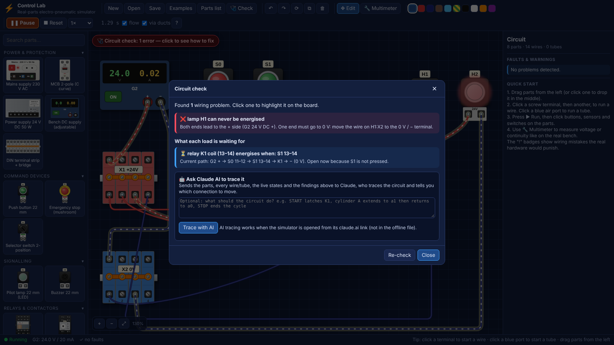
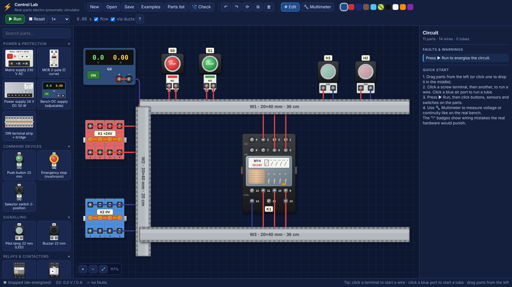
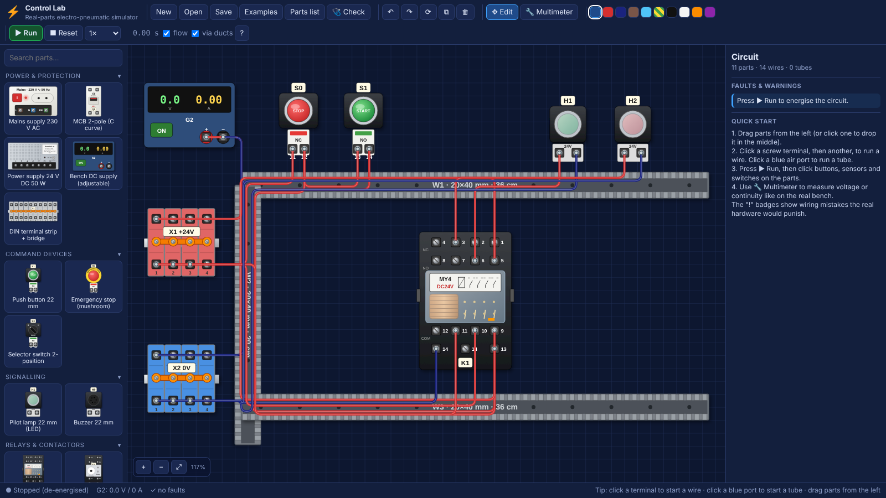

# ⚡ Control Lab: a real-parts electro-pneumatic simulator

[](https://github.com/mohamed-belal-10/control-lab-simulator/actions/workflows/deploy.yml)
[](https://github.com/mohamed-belal-10/control-lab-simulator/actions/workflows/tests.yml)
[](LICENSE)

**Build, wire, run and troubleshoot relay and electro-pneumatic control circuits with the real components you will use on the bench, right in your browser.**

Most circuit simulators draw symbols. Control Lab draws the actual hardware: a 24 V switching power supply, a 2-pole MCB, MY4 relays on their 14-pin sockets, 22 mm push buttons with their contact blocks, PNP sensors with brown/blue/black leads, 5/2 solenoid valves with DIN plugs, cylinders with reed switches, bridged DIN terminal strips and slotted wiring ducts. Every terminal carries the number printed on the real part. A circuit that works here can be wired on the bench terminal-for-terminal. A circuit that is wrong fails the way the hardware would: a breaker trips, a coil burns, a valve won't shift without air. The built-in **Circuit Check** then tells you which wire is wrong and how to fix it.

<p align="center"></p>

> 🌐 **Try it live:** **<https://mohamed-belal-10.github.io/control-lab-simulator/>**
> 🎬 **2½-minute tutorial:** [docs/media/tutorial.mp4](docs/media/tutorial.mp4)

---

## Contents

- [Features](#features)
- [Quick start](#quick-start)
- [How to use it](#how-to-use-it)
- [Circuit Check: finding wiring mistakes](#circuit-check-finding-wiring-mistakes)
- [Wiring ducts](#wiring-ducts)
- [What is simulated](#what-is-simulated)
- [Parts library](#parts-library)
- [Circuit files](#circuit-files)
- [Project structure](#project-structure)
- [How it works](#how-it-works)
- [Build and test locally](#build-and-test-locally)
- [Publishing on GitHub Pages](#publishing-on-github-pages)
- [Contributing](#contributing)
- [License and disclaimer](#license-and-disclaimer)

---

## Features

| | |
|---|---|
| 🔌 **Real parts, real terminals** | About 30 components modelled on catalogue parts (Mean Well LRS-50-24, Omron/GENROON MY4 + PYF14A, Schneider XB2-style buttons, E3F-DS30 / LJ12A3 / LJC18A3 sensors, Airtac 4V210/4V220 valves, magnetic cylinders and more) with their true terminal numbers. |
| 🧵 **Wiring like on the bench** | Click a terminal, then another, to run a wire. Wire colours follow the IEC convention (+24 V red, 0 V dark blue, L brown, N light blue, PE green-yellow). Choose 0.5–2.5 mm² wire, add bends, and branch with bridged terminal strips. |
| 💨 **Electro-pneumatics** | Air supply, filter-regulator, manifold, T-fittings, 5/2 single and double solenoid valves, 3/2 valve, single- and double-acting cylinders, one-way flow controls, silencers, plugs and a gauge. Push-in ports take exactly one tube. |
| 🩺 **Circuit Check** | Runs on every **Run**. It traces every coil, lamp and sensor back to the supply, reports wrong or missing connections with an exact fix, highlights them on the board, and lists what each load is waiting for. |
| 🤖 **Trace with AI** | When the simulator is opened from its claude.ai link, Claude can trace the whole circuit and tell you which wire to move. |
| 🔧 **Multimeter** | V DC / V AC between any two terminals, plus Ω and continuity on the de-energised circuit (e.g. MY4 coil ≈ 650 Ω). |
| 🗂️ **Select, group, align** | Drag a rectangle to select parts (it stays as a fixed frame when you release), drag inside the frame to move them all, group them (<kbd>Ctrl</kbd>+<kbd>G</kbd>) so they move and rotate as one, then align or distribute parts and groups with one click. |
| 📐 **Wiring ducts** | Slotted ducts with length, width and depth set in **cm**. Wires are laid through the duct network automatically, each in its own lane, with the cover on or off. |
| ⚠️ **Realistic faults** | Short circuits, overloads, wrong coil voltages, burnt lamps, welded contacts, reversed sensor polarity, too much current through reed switches and sensor outputs, air leaks, missing pilot pressure. |
| 💾 **Circuit files** | Save as a `.ccs` file, or as a stand-alone `.html` that opens the simulator with your circuit on double-click. There's also a parts and wire shopping list. |
| 📦 **Zero install** | One HTML file with no dependencies. It works offline, on GitHub Pages, or double-clicked from a USB stick. |

## Quick start

- **Online:** open **<https://mohamed-belal-10.github.io/control-lab-simulator/>**.
- **Offline:** download `index.html` from the site (or build it with `python build.py`) and double-click it.
- **First steps:** open **Examples**, load *“4 · Automatic A+ A− with reed switches”*, press **▶ Run**, then press the green **START** button on the board.

The simulator always opens on a clear board. **Restore my last work** in the right panel brings back your previous session.

## How to use it

| Step | What you do |
|---|---|
| **1 · Place** | Drag parts from the library on the left, or type in the search box. Drag a rectangle to select several, drag inside the frame to move them together, <kbd>Ctrl</kbd>+<kbd>G</kbd> to group them, and use **Align** in the right panel to line them up. Right-drag pans the board. |
| **2 · Wire** | Click a screw terminal, then another one. Click empty space on the way to add bends. Tubes start from the blue push-in ports. |
| **3 · Set up** | Click a part to change its settings (coil voltage, contacts, colour, bore and stroke, sensor type…). The panel also shows live readings and real wiring notes. |
| **4 · Run** | **▶ Run** or <kbd>Space</kbd>. Press buttons, put objects in front of sensors, and operate the valves' manual overrides. |
| **5 · Check** | Read the 🩺 chip. Open it to see each problem and its fix, then click a problem to jump to it. |
| **6 · Measure** | 🔧 **Multimeter**: red probe, then black probe. Switch to Ω mode for continuity. |
| **7 · Save** | **Save** (<kbd>Ctrl</kbd>+<kbd>S</kbd>) writes a circuit file. **Open** (<kbd>Ctrl</kbd>+<kbd>O</kbd>) loads it. **Parts list** gives the shopping list. |

The full walkthrough, with every tool and keyboard shortcut, is in **[docs/USER_GUIDE.md](docs/USER_GUIDE.md)**.

## Circuit Check: finding wiring mistakes

<p align="center"></p>

When you press **Run**, a chip shows the result of the trace: red for errors, orange for warnings, green when the wiring is sound. Each finding tells you **where** the problem is and **how to fix it**. It catches, among other things:

- a coil or lamp terminal left unconnected, or both ends of a load going to + (or both to 0 V)
- a 24 V DC coil fed from 230 V AC, or a 220 V AC MY4 coil on 24 V DC
- shorts, both the ones present now and the ones that happen when a contact closes
- a wire on a NO or NC pin while that pole's COM is empty, and relay contacts used while the coil is not wired
- reversed sensor polarity, reed switches not mounted on a cylinder, and loads fed from two separate supplies
- air supply problems: valve port 1 without supply, cylinder ports missing tubes or tubed to an exhaust, both cylinder ports on one line

If nothing is wrong but nothing moves, it lists what each coil is waiting for, for example *“solenoid Y1 energises when K1 10–6 + K2 9–5. Open now because K1 is not energised.”*

## Wiring ducts

| Cover on: the finished panel | Cover off: each wire in its own lane |
|---|---|
|  |  |

Add **Wiring duct (slotted)** from *Panel & wiring*, set its length, width and depth in cm, and rotate it with <kbd>R</kbd> for vertical runs. Ducts that touch or cross form one network. With **via ducts** ticked in the toolbar, new wires are laid through the ducts automatically. Select a duct and use **Route all wires through ducts** to tidy existing wiring.

## What is simulated

| Real-world behaviour | In the simulator |
|---|---|
| Ohm's law, AC and DC separately | A nodal-analysis solver handles AC and DC by superposition, with wire and contact currents. |
| Short circuit on mains | The MCB trips magnetically (> 7 × In). With no MCB, the building breaker trips. |
| Overload | The MCB trips thermally after a delay. The PSU goes into hiccup mode above 150 %. The bench supply limits current. |
| Wrong coil voltage or type | A coil burns at over-voltage, won't pull in below 80 %, and AC on a DC coil (or the reverse) is flagged. |
| Relay timing | Pull-in takes about 15 ms and drop-out about 8 ms. Contacts weld under heavy over-current. |
| Pilot-operated valves | Valves need ≥ 1.5 bar at port 1 to shift, with about 30 ms spool response. Double-solenoid valves remember their position. |
| Cylinders | Speed depends on pressure and the flow-control setting (meter-in or meter-out). Force = p × A. Single-acting cylinders have spring return. |
| Sensors | 6–36 V supply, PNP or NPN, NO or NC. Outputs are protected at 200 mA and reed switches at 100 mA. |
| Installation rules | Max 2 wires per screw terminal and 1 tube per push-in port. Wire cross-section is checked against the current. |

## Parts library

Power and protection · command devices · signalling · relays and contactors · sensors · loads · air supply · valves · actuators · fittings · panel and wiring.
Every part, its settings and the meaning of each terminal are listed in **[docs/PARTS.md](docs/PARTS.md)** (generated from the code).

## Circuit files

| File | What it is | How to open it |
|---|---|---|
| `name.ccs` | The circuit (JSON inside) | **Open** in the simulator |
| `name.html` | The simulator with the circuit embedded | Double-click it, or **Open** it |
| `examples/*.ccs` | The five built-in examples | **Open** |

The file format is described in [docs/ARCHITECTURE.md](docs/ARCHITECTURE.md#circuit-file-format).

## Project structure

```
control-lab-simulator/
├── src/                     ← the simulator source (plain HTML/CSS/JS, no framework)
│   ├── index.html           page shell (toolbar, panels, canvas)
│   ├── styles.css           dark theme
│   └── js/                  modules, loaded in file-name order
│       ├── 00-util.js           namespace, helpers, dialogs
│       ├── 01-shell.js          page shell copy (for stand-alone circuit files)
│       ├── 10-catalog-core.js   part registry + SVG drawing helpers
│       ├── 20…25-parts-*.js     the parts library (power, command, relays, sensors, pneumatics, ducts)
│       ├── 30-elec.js           electrical solver (modified nodal analysis)
│       ├── 31-pneu.js           pneumatic solver
│       ├── 40-circuit.js        circuit model, save/load, undo, reed mounting
│       ├── 42-arrange.js        groups, align, distribute, group rotation
│       ├── 45-ducts.js          wire routing through ducts
│       ├── 50-sim.js            simulation loop + installation checks
│       ├── 55-doctor.js         Circuit Check (tracing, fault finding, AI prompt)
│       ├── 60-render.js         SVG renderer
│       ├── 70-ui.js             editor UI, multimeter, dialogs, files
│       ├── 80-examples.js       example circuits
│       └── 99-main.js           boot + animation loop
├── build.py                 bundles src/ into dist/index.html
├── examples/                example circuits as .ccs files
├── docs/                    user guide, parts reference, architecture, screenshots, tutorial video
├── tests/                   browser tests (Playwright)
├── tools/                   regenerates docs/PARTS.md, screenshots and example files
└── .github/                 GitHub Pages deployment, CI tests, issue templates
```

## How it works

1. Every part is a plain object registered with `CCS.defType({...})`. It declares its terminals, its electrical elements (resistors, switches, sources), its pneumatic connections, its behaviour over time and an SVG drawing.
2. Every 5 ms the **electrical solver** builds a netlist from wires and parts and solves it with modified nodal analysis. It runs separate AC and DC passes from one LU factorisation, and iterates until breakers, sensors and supplies settle.
3. The **pneumatic solver** groups tubed ports into nodes, follows valve passages and regulators, and labels every node as pressurised, exhausted, trapped or leaking. Cylinders move from that.
4. The **Circuit Check** builds a graph of conductors and contacts and runs shortest-path searches (0-1 BFS) from each supply pole to each load.

Details: **[docs/ARCHITECTURE.md](docs/ARCHITECTURE.md)**.

## Build and test locally

```bash
python build.py                              # → dist/index.html  (Python 3.8+, nothing to install)
pip install -r tests/requirements.txt        # optional: browser tests
python -m playwright install chromium
python tests/test_simulator.py               # 26 tests: physics, circuit check, files, ducts, selection
python tools/generate_docs_assets.py         # refresh docs/PARTS.md, screenshots, examples/*.ccs
```

To work on the code, open `dist/index.html` in a browser after each `python build.py`.

## Publishing on GitHub Pages

The site is deployed by GitHub Actions to **<https://mohamed-belal-10.github.io/control-lab-simulator/>**. Every push to `main` rebuilds and redeploys the site automatically. Step-by-step instructions, including troubleshooting, are in **[docs/PUBLISHING.md](docs/PUBLISHING.md)**.

## Contributing

New parts, better models and bug reports are welcome. See **[CONTRIBUTING.md](CONTRIBUTING.md)** for how a part is defined, the coding conventions and how to test. The change history is in [CHANGELOG.md](CHANGELOG.md).

## License and disclaimer

Released under the [MIT License](LICENSE).

Control Lab is a **training and planning tool**. Its models are simplified, so always follow the datasheets of your actual parts and your lab's safety rules. Mains-voltage wiring must be done and checked by a qualified person, with the supply isolated.

Made for the Mechatronics Lab (MCTR704) at the German University in Cairo.
